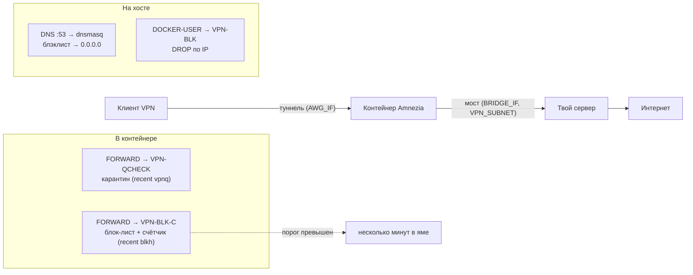

# 🐟 Omerta Enforcer

> **«1 проёб — 2 зуба нахуй. 5 попаданий — 3 минуты в яме.»**
>
> *Домены нарушают омерту — спят с рыбами. Клиенты нарушают омерту — спят в карантине.*

Блэклист доменов и IP для Amnezia VPN (AmneziaWG в Docker) с тремя уровнями «воспитания»:

| Слой | Что делает | Где живёт |
|---|---|---|
| **Омерта** | Заблокированный домен резолвится в `0.0.0.0` (и все субдомены) — клиент даже не узнаёт настоящий IP | dnsmasq на хосте + перехват порта 53 из VPN |
| **Конкретный разговор** | Пакеты на IP блок-листа дропаются на хосте (`DOCKER-USER`) и внутри контейнера | `vpn-blocklist.sh`, пересборка раз в 5 минут |
| **Enforcer** | Клиент стукнулся в блок-лист N раз за окно → весь его трафик в DROP на BANTIME секунд | `-m recent` внутри netns контейнера |

Плюс веб-морда **только изнутри VPN**: списки, массовое удаление галочками, карантин с кнопкой разбана и настройками.



## Быстрый путь (для нетерпеливых)

```bash
git clone <адрес>/omerta-enforcer.git
cd omerta-enforcer
sudo bash install.sh
```

Установщик спросит 5 значений раскладки твоего сервера (как их узнать — «Шаг 0» ниже), всё остальное сделает сам: пакеты, конфиги, токен, iptables, systemd, UI. Идемпотентный — повторный запуск безопасен, живые списки, токен и раскладку не затирает.

---

## Путь по-честному: сделай сам

Хочешь понимать каждый винтик — проходи шаги руками. Ничего магического: dnsmasq, iptables и systemd. Подразумевается Ubuntu 22.04+ с Docker и рабочим Amnezia (AmneziaWG в контейнере).

### Шаг 0. Разведка: узнай, где лежат деньги

Прежде чем что-то ставить, выпиши **свои** значения — они у каждого свои, Amnezia генерит подсети случайно при установке.

**1) Имя контейнера Amnezia:**
```bash
docker ps --format '{{.Names}}'
```

**2) Мост и подсеть:**
```bash
ip -brief addr
```
Ищи интерфейс с адресом вида `172.x.x.1/24`, **кроме** `docker0` (это дефолтный мост Docker, не наш). Запиши: имя интерфейса, IP моста (`x.x.x.1`), подсеть (`x.x.x.0/24`).

**3) Туннельный интерфейс и подсеть клиентов:**
```bash
docker exec <контейнер> ip a
```
Ищи WireGuard-подобный интерфейс (обычно `awg0`) с подсетью вида `10.8.x.0/24` — её адреса будут попадать в карантин.

**4) Свободен ли порт 53:**
```bash
ss -tulnp | grep :53
```
Пусто — отлично. Если там `systemd-resolved` на `127.0.0.53` — сначала разберись с ним, иначе dnsmasq не стартует.

Дальше в примерах — условные значения: контейнер `my-amnezia`, мост `wg-br` с IP `172.30.100.1` и подсетью `172.30.100.0/24`, туннель `awg0`. **Всюду подставляй свои.**

### Шаг 1. Пакеты

```bash
sudo apt update
sudo DEBIAN_FRONTEND=noninteractive apt install -y dnsmasq dnsutils iptables-persistent python3-flask
```

| Пакет | Зачем |
|---|---|
| `dnsmasq` | DNS-сервер с блэклистом (слой «омерта») |
| `dnsutils` | `dig` для проверок |
| `iptables-persistent` | Правила переживают ребут |
| `python3-flask` | Веб-морда |

### Шаг 2. Омерта: DNS-фильтр

```bash
sudo nano /etc/dnsmasq.d/vpn-blacklist.conf
```

```ini
listen-address=127.0.0.1,172.30.100.1
bind-interfaces
no-resolv
server=1.1.1.1
server=8.8.8.8
cache-size=1000

address=/example.com/0.0.0.0
address=/example.com/::
```

`172.30.100.1` — **IP твоего моста** из Шага 0. Пара строк `example.com` — проверочный пример, свои домены добавишь хелпером. Запись `address=/домен/` душит и все субдомены.

```bash
sudo systemctl restart dnsmasq
dig example.com @127.0.0.1 +short   # → 0.0.0.0
dig google.com @127.0.0.1 +short    # → реальный IP
```

⚠️ dnsmasq — единая точка: если он упадёт, у всех VPN-клиентов умирает DNS. Поэтому дальше везде перед рестартом стоит проверка `dnsmasq --test`.

### Шаг 3. Никто не говорит с резолверами без семьи

Любой DNS-запрос из VPN-подсети перехватывается и заворачивается в наш dnsmasq — даже если клиент прописал себе 8.8.8.8.

```bash
sudo iptables -t nat -A PREROUTING -i wg-br -s 172.30.100.0/24 -p udp --dport 53 -j DNAT --to-destination 172.30.100.1:53
sudo iptables -t nat -A PREROUTING -i wg-br -s 172.30.100.0/24 -p tcp --dport 53 -j DNAT --to-destination 172.30.100.1:53
sudo netfilter-persistent save
```

(`wg-br` и подсеть — твои значения из Шага 0.)

### Шаг 4. Раскладка: env-файл

```bash
sudo nano /etc/omerta-enforcer.env
```

```bash
# Раскладка этого сервера (значения из Шага 0)
CTR="my-amnezia"           # имя контейнера Amnezia
BRIDGE_IF="wg-br"          # интерфейс моста
BRIDGE_IP="172.30.100.1"   # IP моста
VPN_SUBNET="172.30.100.0/24"
AWG_IF="awg0"              # туннель внутри контейнера
```

Из этого файла читают все скрипты и UI — поменял один файл, обновилась вся семья.

### Шаг 5. Скрипты семьи

```bash
sudo install -m 755 scripts/vpn-blocklist.sh /usr/local/sbin/
sudo install -m 755 scripts/vpn-block-add.sh  /usr/local/sbin/
sudo /usr/local/sbin/vpn-blocklist.sh
```

Проверка, что правила легли в оба места:

```bash
sudo iptables -S VPN-BLK | head -5                     # хост: DOCKER-USER → VPN-BLK
docker exec <контейнер> iptables -S FORWARD | head -5  # контейнер: VPN-QCHECK, VPN-BLK-C
```

### Шаг 6. Сердце не должно останавливаться: systemd

```bash
sudo install -m 644 systemd/vpn-blocklist.service /etc/systemd/system/
sudo install -m 644 systemd/vpn-blocklist.timer  /etc/systemd/system/
sudo systemctl daemon-reload
sudo systemctl enable --now vpn-blocklist.timer
```

Таймер пересобирает цепочки раз в 5 минут: плавающие IP блок-листа и правила карантина внутри контейнера всегда актуальны. Контейнер пересоздали? Цепочки восстановятся тиком таймера.

### Шаг 7. Кабинет: веб-морда

```bash
# токен доступа: генерится один раз, никому не показывается
openssl rand -hex 16 | sudo tee <файл токена>   # путь файла — см. install.sh

sudo mkdir -p /opt/blocklist-ui
sudo install -m 644 ui/app.py /opt/blocklist-ui/
sudo install -m 644 systemd/blocklist-ui.service /etc/systemd/system/
sudo systemctl daemon-reload
sudo systemctl restart blocklist-ui.service
```

Морда слушает только IP моста из env-файла — из интернета её не существует. Открываешь **под VPN**: `http://<IP-моста>:8800`.

### Шаг 8. Проверка, кто твой друг

1. С клиента под VPN: `dig example.com` → `0.0.0.0`, гугл работает
2. Добавь что-нибудь через UI или `sudo vpn-block-add.sh домен`
3. Тест карантина: 5–6 раз с клиента стукнись в заблокированный IP (`Test-NetConnection <IP> -Port 443` в Windows) → весь трафик этого устройства через VPN умрёт на несколько минут. Это проверка enforcer'а, не паникуй.

---

## Эксплуатация: правила семьи

| Задача | Как |
|---|---|
| Добавить домены / IP / подсети | UI (одно поле, списком вперемешку) или `sudo vpn-block-add.sh dom1.ru 1.2.3.4 5.6.0.0/16` |
| Удалить | UI: галочки → «Удалить отмеченные», или ✕ по одному |
| Забаненный клиент | UI: «Карантин» → «✕ Разбанить» (снимется и само, через BANTIME) |
| Настроить карантин | UI: «Настройки карантина» (попадания 1–20, окно, длительность бана) или `/etc/vpn-quarantine.conf` |
| Разбан из консоли | `docker exec <контейнер> sh -c 'echo -<ip> > /proc/net/xt_recent/vpnq; echo -<ip> > /proc/net/xt_recent/blkh'` |

**Железное правило:** домены добавляй только через UI или `vpn-block-add.sh`. Руками в файлы списков не пишем — хелпер синхронизирует оба слоя сразу, ручная правка оставляет домен «заблокированным наполовину» (красная строка в UI).

Файлы на сервере: скрипты → `/usr/local/sbin/`, раскладка/списки/карантин → `/etc/`, dnsmasq-конфиг → `/etc/dnsmasq.d/`, UI → `/opt/blocklist-ui/`.

## Если кто-то заикался: troubleshooting

| Симптом | Что смотреть |
|---|---|
| Заблокированный сайт открывается под VPN | В UI у домена красный IP → `vpn-block-add.sh <домен>` дотянет слой. Если всё зелёное — кэш клиента: `ipconfig /flushdns`, инкогнито |
| UI не открывается | Он существует только под VPN. Проверь split tunneling в клиенте Amnezia (подсеть моста должна идти в туннель) |
| Клиент сам себя забанил (приложения с зашитыми IP долбятся в блок-лист) | «Карантин» → «Разбанить», либо подними порог |
| У всех клиентов пропал DNS | dnsmasq — единая точка: `systemctl status dnsmasq`, `dnsmasq --test` |
| Скрипт упал, цепочка пустая | `journalctl -u vpn-blocklist.service -n 40` — там traceback |

## Токен

Токен доступа к UI генерится на сервере при установке (`install.sh`)

---

*Remember: never rat on your friends, and always keep your mouth shut about what's on the list.*